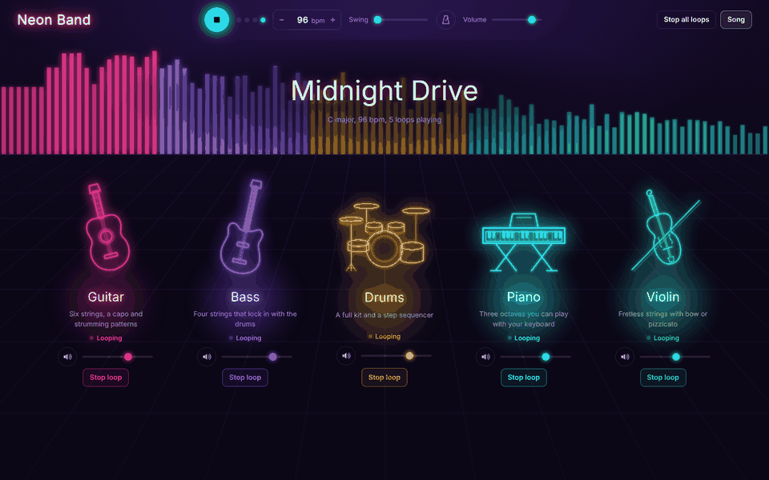
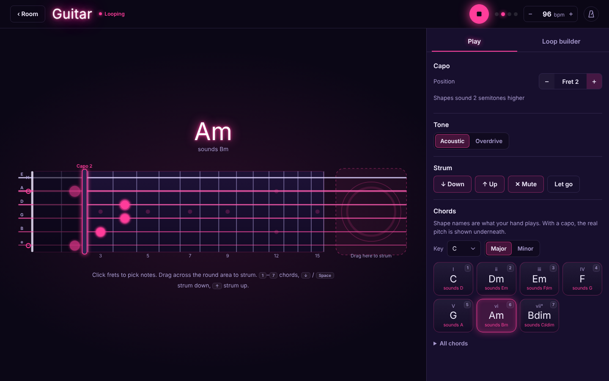
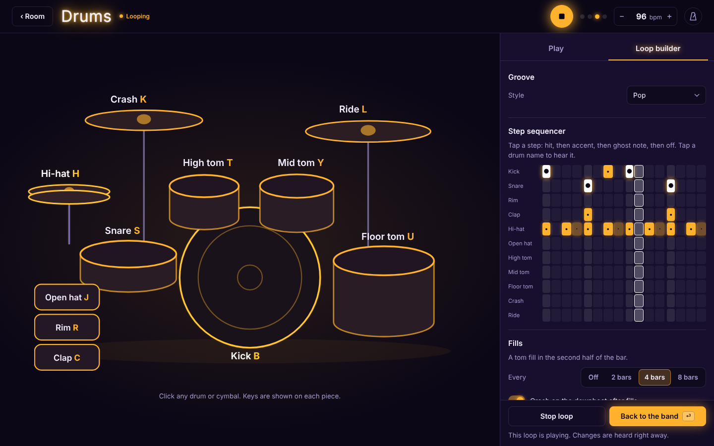
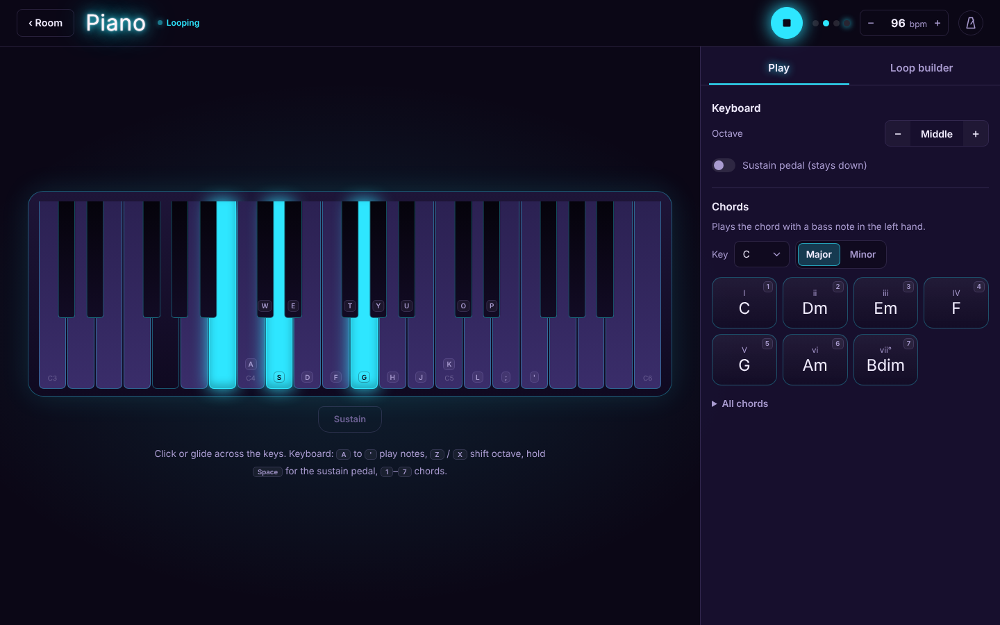
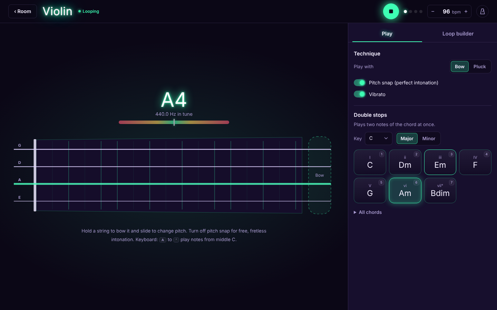
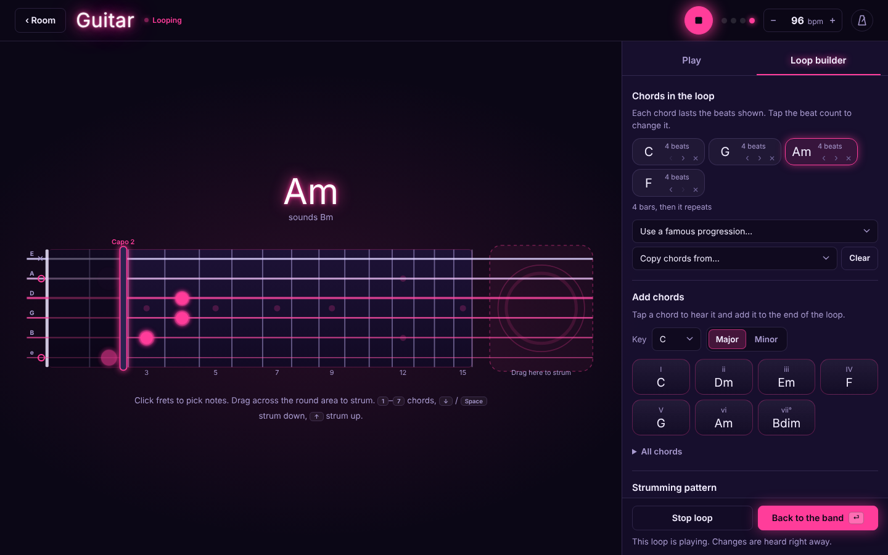
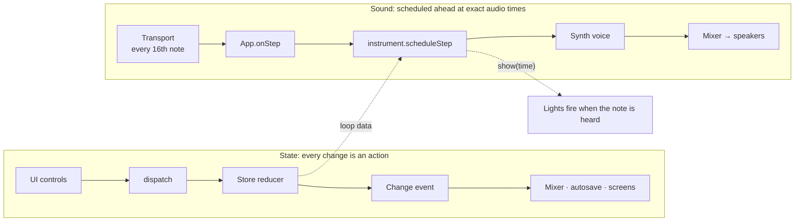
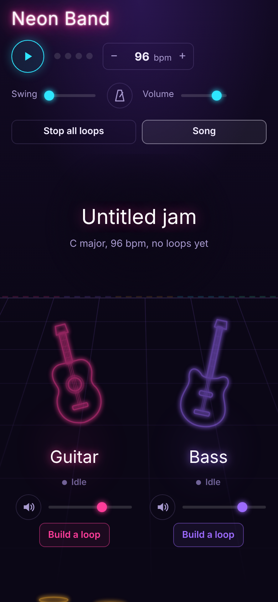

<div align="center">

# 🎸 Neon Band

### A full band in your browser. Five instruments, real music theory, zero samples.

Play guitar, bass, drums, piano and violin by hand, build loops for each one,<br/>
and stack them into a song — all in a neon-lit room, all synthesized live in code.

<br/>

[](https://nancyaanchal.github.io/Neon-Band/)

<br/>

[](https://github.com/NancyAanchal/neon-band/actions/workflows/deploy.yml)


<br/>



<sub>Every instrument glows with its <b>real</b> audio level. The back wall is a live spectrum analyser.</sub>

</div>

<br/>

## ✨ Why it's cool

- 🎼 **Pitch-perfect by math, not samples.** Every note is computed in equal temperament (A4 = 440 Hz). Guitar strings are measured within **0.28 cents** of perfect pitch; you can't hear under ~5.
- 🎸 **Every chord, every key.** 16 chord types × 12 keys = **192 chords**, and the guitar finds a real, playable fingering for every one of them, with a working **capo**.
- 🥁 **Tight as a studio clock.** A lookahead scheduler books every note ahead of time at sample-accurate audio times, so five instruments stay locked together even when the UI is busy.
- 🔁 **Loops land on the beat.** Send a loop to the band mid-song and it waits for the next bar line, so it always comes in on beat one.
- 🎹 **Plays like the real thing.** Strums ring string by string. Pianos voice-lead smoothly between chords. The violin is fretless: slide your finger and the pitch slides with you, with a live tuner.
- 🧩 **Built to grow.** Adding an instrument is one folder plus one line. Every song change is a plain serializable action, ready for multiplayer.
- 📦 **Tiny.** No frameworks, no runtime dependencies, no audio files. The whole game ships as ~33 KB of gzipped JavaScript.

<br/>

## 🎛️ The band

<table>
  <tr>
    <td width="50%"></td>
    <td width="50%"></td>
  </tr>
  <tr>
    <td><b>🎸 Guitar</b> — pick frets, drag to strum, capo 0–12, acoustic or overdrive, 10 strumming patterns + your own.</td>
    <td><b>🥁 Drums</b> — 11 synthesized voices, 12 grooves, a full 16-step sequencer and automatic tom fills.</td>
  </tr>
  <tr>
    <td></td>
    <td></td>
  </tr>
  <tr>
    <td><b>🎹 Piano</b> — 3 octaves, mouse glissando, computer-keyboard play, sustain pedal, 8 comping styles.</td>
    <td><b>🎻 Violin</b> — fretless strings, bow or pluck, vibrato, pitch snap, live tuner, generated melodies.</td>
  </tr>
</table>

Plus a **🎸 Bass** with finger and pick tones and 9 grooves, including a walking line that leads chromatically into the next chord.

<br/>

## 🔁 Build a song in four moves



1. **Open an instrument.** Click it in the room; the view zooms in.
2. **Build its loop.** Pick chords (or a famous progression like I–V–vi–IV, the 12-bar blues or Canon), then a strumming pattern, groove or style.
3. **Press Enter.** The loop joins the band on the next bar and you're back in the room.
4. **Repeat.** Stack all five. Edit any loop while it plays and hear the change instantly.

Use **Copy chords from…** to make the whole band follow one progression in seconds.

<br/>

## 🧠 How it sounds real

No recordings. Each instrument uses the synthesis method that matches how the real one makes sound:

| Instrument | Technique |
| --- | --- |
| **Guitar & bass** | Karplus-Strong plucked string with an **all-pass fractional delay**, so tuning is exact instead of ~20 cents flat on high notes. Pick-position comb filtering, body-resonance EQ, optional tube-style overdrive. |
| **Piano** | Additive synthesis: up to 16 partials with real **string inharmonicity**, two detuned strings per note for natural chorus, two-stage decay and a felt-hammer thump. |
| **Violin** | Real-time bowed string: detuned sawtooths through violin **body resonances** (280 / 470 / 2700 Hz), delayed vibrato and rosin noise. Pitch glides continuously. |
| **Drums** | Pitch-swept sines for kick and toms, noise + body for snare, six inharmonic square waves for 808-style cymbals, multi-burst clap. Closed hats choke open hats. |

Everything runs through a mixer with per-instrument panning, a convolution reverb, a bus compressor and a limiter.

<br/>

## 🏗️ Architecture



- **One source of truth.** The whole song is one JSON object. Every change is a plain `Action` through `store.dispatch()` and a pure reducer.
- **The clock drives the music.** The transport wakes every 25 ms and schedules the next 120 ms with sample-accurate timing ("A Tale of Two Clocks").
- **Visuals follow sound.** Notes are booked ahead, so lights are queued to fire exactly when each note becomes audible.
- **Instruments are plugins.** The room, mixer, loop system and save files all discover instruments from one registry.

<br/>

## 🚀 Quick start

```bash
git clone https://github.com/NancyAanchal/neon-band.git
cd neon-band
npm install
npm run dev
```

| Command | What it does |
| --- | --- |
| `npm run dev` | Dev server with hot reload |
| `npm run build` | Type-check + production build in `dist/` |
| `npm run build:single` | The whole game as **one** self-contained HTML file |
| `npm run typecheck` | Strict type-check only |

Every push to `main` deploys to GitHub Pages automatically via `.github/workflows/deploy.yml`.

<br/>

## ⌨️ Controls

| Where | Keys |
| --- | --- |
| Room | `Space` play/stop · `1`–`5` open an instrument |
| Any instrument | `1`–`7` chords of the key · `Enter` send loop · `Esc` back |
| Guitar | `↓` / `Space` strum down · `↑` strum up |
| Piano | `A W S E D F T G Y H U J K O L P ; '` notes · `Z` / `X` octave · hold `Space` sustain |
| Drums | `B` kick · `S` snare · `H` hat · `J` open hat · `T` `Y` `U` toms · `K` crash · `L` ride · `R` rim · `C` clap |
| Violin | `A` … `'` notes, held while pressed |

<br/>

## 📁 Project structure

```
src/
├── app/            App wiring, screen routing, autosave
├── core/           Store, actions, typed event bus
├── audio/          Mixer, lookahead transport
│   └── synth/      pluck · piano · bowed · drums
├── music/          Theory, chords, progressions, guitar shape engine
├── instruments/    guitar · bass · drums · piano · violin · shared views
├── ui/             DOM helpers, components, screens
└── styles/         One CSS file, theme tokens up top
```

<br/>

## 🧩 Add your own instrument

One folder and one line. Extend the base class, then register it:

```ts
export class TrumpetInstrument extends ChordInstrument<TrumpetLoop, TrumpetSettings> {
  readonly id = 'trumpet';
  readonly name = 'Trumpet';
  readonly color = '#ff8a3d';
  readonly blurb = 'Brass that cuts through the mix';

  scheduleStep(localStep: number, time: number) {
    const pos = this.loopChord(localStep); // which chord is playing right now
    // schedule notes at `time`...
  }
  // + mountStage, mountPlayPanel, mountAutoPanel, roomArt, previewChord
}
```

```ts
// src/instruments/registry.ts
export const BAND = [GuitarInstrument, BassInstrument, DrumsInstrument, PianoInstrument, ViolinInstrument, TrumpetInstrument];
```

It instantly gets a spot on stage, a mixer channel, a loop builder with the chord-progression editor, and a place in save files.

<br/>

## 📱 Works on your phone too



The layout adapts down to phone size. Instruments keep a playable size and scroll sideways instead of shrinking into tiny targets. Touch, multi-touch and drag-strumming all work.

Songs autosave in your browser, and the **Song** menu lets you copy, download or load any song as JSON.

<br clear="right"/>

## 🗺️ Roadmap

- [ ] **Multiplayer jam rooms** — the action system and store middleware are already in place
- [ ] Recorded samples as an optional upgrade, instrument by instrument
- [ ] Song sections (verse / chorus / bridge) and arrangement
- [ ] Undo and redo
- [ ] More instruments: trumpet, sax, synth pads
- [ ] Export your song as a WAV file

<br/>
